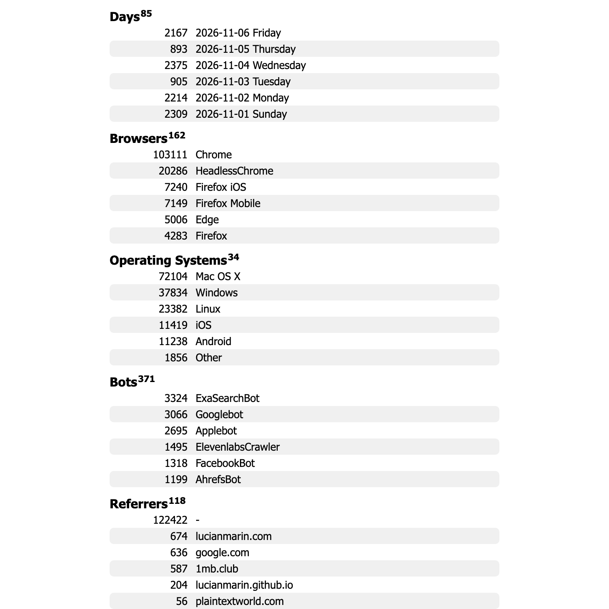

# Logparser



Command line parser for common log format (Nginx default).

## Install

### Python

Requires Python 3. Create a virtual environment and install the dependencies:

```shell
python3 -m venv venv
source venv/bin/activate
pip install -U -r requirements.txt
```

The `venv/` directory is local to the repository. Activate it in each new shell before running `parse.py`, and run `deactivate` to leave it.

### Pura

The native implementation is `logparser.pura`. Build and install it with `make`:

```shell
make                # compile ./logparser from logparser.pura
sudo make install   # install to /usr/local/bin (system-wide)
make install        # install to ~/.local/bin (per-user)
```

`make install` uses `/usr/local` when run as root and `~/.local` otherwise. Override `PREFIX` or `DESTDIR` as needed, and pass `PURA=/path/to/pura` if the compiler is not on `PATH`. Other targets are `make check`, `make uninstall` and `make clean`.

## Usage

It counts most important data: referrers, operating systems, browsers and daily unique visitors (IPs). It excludes bots by default.

The examples use `python3 parse.py`; replace it with `logparser` when using the native binary.

```shell
# Console output
python3 parse.py sitename.log.gz
python3 parse.py sitename.log.gz sub.sitename.log.gz

# Hide less than or equal values
python3 parse.py sitename.log.gz --hide 1

# HTML output
python3 parse.py sitename.log.gz --html ~/sitename/logs.html

# Ignore hostnames from referrers
python3 parse.py sitename.log.gz --skip subreply.com
python3 parse.py sitename.log.gz --skip *.subreply.com  # only subdomains

# Drop logs older than specified days and rebuild log file
python3 parse.py sitename.log.gz --drop 30
```

## Benchmark

Measured on `logs/sub.log.gz` (1,968,224 lines, 42.86 MiB gzipped) on Apple M4 (10 cores):

| Tool | Command / Mode | Median | Min – Max | Throughput | Relative |
|---|---|---:|---:|---:|---:|
| `logparser` | Native Pura binary | 1.197s | 1.194s – 1.199s | 1,643,809 lines/s | 1.0× |
| `goaccess` (`-j 6`) | `gzcat` \| GoAccess 1.12 (6 threads) | 9.002s | 8.900s – 9.006s | 218,635 lines/s | 7.5× slower |
| `parse.py` | Python 3.14 (`venv`) | 16.465s | 16.464s – 16.531s | 119,537 lines/s | 13.8× slower |
| `goaccess` (default) | `gzcat` \| GoAccess 1.12 (1 thread) | 34.434s | 34.221s – 34.647s | 57,159 lines/s | 28.8× slower |

GoAccess does not read `.gz` files directly, so `gzcat` was piped with `--log-format=COMBINED --no-progress -o <tmp.html>`. Values are medians of 3 warmed runs (2 runs for default single-threaded GoAccess).

## Outputs

- HTML output is based on Jinja2 templates. It can be improved as you see fit.
- Console output for [Subreply](https://subreply.com/) for a fews days in Sep, 2021:

```shell
----- Days
 1402 2021-09-14 Tuesday
  893 2021-09-15 Wednesday
  797 2021-09-16 Thursday
  857 2021-09-17 Friday
  951 2021-09-18 Saturday
  945 2021-09-19 Sunday
  869 2021-09-20 Monday

----- Browsers
    2 Chrome Mobile iOS
    2 Bytespider
    2 HeadlessChrome
    3 Links
    4 Firefox iOS
    4 UC Browser
    6 IE
    7 Go-http-client
    7 Opera
    8 Other
   20 Chrome Mobile WebView
   20 Edge
   28 Firefox Mobile
   30 Safari
   42 Chrome Mobile
   56 Mobile Safari
  111 Firefox
 3468 Chrome

----- Operating Systems
   15 Other
   22 Ubuntu
   39 Linux
   63 iOS
   91 Android
  101 Mac OS X
 3474 Windows

----- Referrers
    2 twtxt.net
    2 l.instagram.com
    2 lobste.rs/s/bffayk/what_are_you_doing_this_weekend
    3 ro.linkedin.com
    3 199.247.2.88:80
    3 t.co/sv4adihlka
    3 lobste.rs/s/fe2eph/what_are_you_doing_this_weekend
    4 news.ycombinator.com
    4 1mb.club
    4 old.reddit.com/r/internetisbeautiful
    4 baidu.com
    4 t.co
    5 out.reddit.com/t3_pl9hiu
    5 sjmulder.nl/en/textonly.html
    8 nt
   10 199.247.2.88
   11 lobste.rs
   13 sjmulder.nl
   15 google.com
   16 lucianmarin.com
   49 reddit.com
   85 lobste.rs/s/8fzzmz/what_are_you_doing_this_week
```
